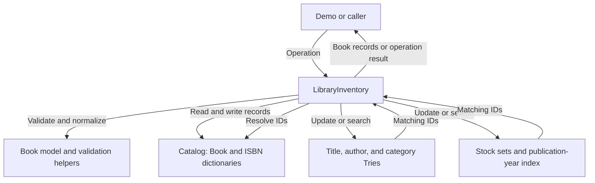

# Library Inventory Tracker

A Python proof of concept for a small library catalog. It keeps book records in memory and supports exact lookups, prefix searches, stock tracking, and publication-year searches.

Each record represents one book edition. The internal ID is unique, ISBN is optional, and quantity is the number of copies. Individual physical copies are not tracked.

## What it supports

- Add and remove books.
- Find a book by internal ID or normalized ISBN.
- Search titles, authors, and categories by prefix.
- Find books within an inclusive year range.
- Update quantities and list in-stock or out-of-stock books.

Search text is normalized to lowercase with punctuation removed and whitespace collapsed. Prefix searches match from the beginning of a field and return books sorted by internal ID.

## Main files

| File | Purpose |
| --- | --- |
| models.py | Frozen Book records, normalization, and validation |
| catalog.py | Book and ISBN dictionaries, lookups, and duplicate checks |
| trie.py | Reusable prefix-search index |
| indexes.py | Stock sets and year buckets with sorted distinct years |
| inventory.py | Coordinates all 11 public operations and index updates |
| demo.py | Demonstrates normal operations and expected errors |

## Data flow

LibraryInventory coordinates validation, catalog changes, and index updates. For searches, the indexes return IDs, which the inventory resolves to the current Book records.



## Run the demo

Use Python 3.10 or later. No third-party packages are required. Run these commands from the repository root.

```sh
python3 demo.py
```

Choose mode 1 to try your own inputs, or mode 2 for the guided walkthrough. Mode 2 first shows all six raw sample records, then pauses before each group of operations.

The demo shows lookups, searches, stock changes, removal, and rejected invalid inputs. Each run starts with a new in-memory inventory.

## Run the tests

Run both commands to include the component and integration tests:

```sh
python3 -m unittest discover -s . -v
python3 -m unittest discover -s tests -v
```

There are 39 component tests and 14 integration tests, 53 in total. The integration tests use the actual model, catalog, Trie, and index modules.

## Limits

Data is lost when the process exits. Metadata editing, loans and returns, persistent storage, and concurrent updates are outside this proof of concept. Expected validation errors are checked before changes; unexpected runtime failures do not have transactional rollback.
