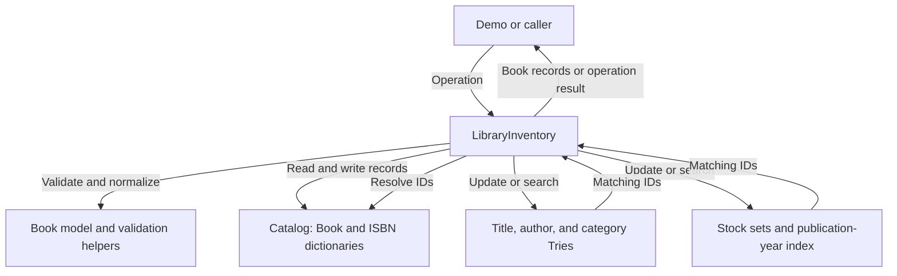

# Library Inventory Tracker

A Python proof of concept for a small library catalog. It keeps book records in memory and supports exact lookups, prefix searches, stock tracking, and publication-year searches.

Each record represents one book edition. The internal ID is unique, ISBN is optional, and quantity is the number of copies. Individual physical copies are not tracked.

## What it supports

- Add and remove books.
- Find a book by internal ID or normalized ISBN.
- Search titles, authors, and categories by prefix.
- Find books within an inclusive year range.
- Update quantities and list in-stock or out-of-stock books.

Search text is normalized to lowercase with punctuation removed and whitespace collapsed. Prefix searches match from the beginning of a field and return books sorted by internal ID.

## Main files

| File | Purpose |
| --- | --- |
| models.py | Frozen Book records, normalization, and validation |
| catalog.py | Book and ISBN dictionaries, lookups, and duplicate checks |
| trie.py | Reusable prefix-search index |
| indexes.py | Stock sets and year buckets with sorted distinct years |
| inventory.py | Coordinates all 11 public operations and index updates |
| demo.py | Demonstrates normal operations and expected errors |

## Data flow

LibraryInventory coordinates validation, catalog changes, and index updates. For searches, the indexes return IDs, which the inventory resolves to the current Book records.



## Run the demo

Use Python 3.10 or later. No third-party packages are required. Run these commands from the repository root.

```sh
python3 demo.py
```

Choose mode 1 to try your own inputs, or mode 2 for the guided walkthrough. Mode 2 first shows all six raw sample records in a table, then pauses before each group of operations.

The demo shows lookups, searches, stock changes, removal, and rejected invalid inputs. Each run starts with a new in-memory inventory.

## Run the tests

Run both commands to include the component and integration tests:

```sh
python3 -m unittest discover -s . -v
python3 -m unittest discover -s tests -v
```

There are 39 component tests and 14 integration tests, 53 in total. The integration tests use the actual model, catalog, Trie, and index modules.

## Limits

Data is lost when the process exits. Metadata editing, loans and returns, persistent storage, and concurrent updates are outside this proof of concept. Expected validation errors are checked before changes; unexpected runtime failures do not have transactional rollback.

## Official Phase 3 Group 2 curveball: `top_k_scarce(k)`

**Only in-stock books are eligible** (`quantity > 0`). Return up to `k` books
in ascending `(quantity, book.id)` order, and never modify application state.
This is the professor's exact Group 2 requirement. Out-of-stock books are EXCLUDED.
The old `top_k_low_stock(k)` demonstration, which included zero-quantity books,
was superseded and must not be used.

Implementation: `LibraryInventory.top_k_scarce(k)` selects from the existing
`in_stock` index using `heapq.nsmallest`, O(n_in_stock log k) time and O(k)
selection space when 0 < k < n_in_stock, versus O(n log n) full sorting.
The special cases `k=0`, `k>n_in_stock`, invalid values, ties, mutations,
and empty inventories have automated tests.

### Run locally (Windows)

```powershell
py -m unittest discover -s . -v
py -m unittest discover -s tests -v
py demo.py
py benchmark_phase3.py --size 3000
py benchmark_topk_group2.py --size 10000
py benchmark_topk_group2.py --size 100000
py -m cProfile -s tottime benchmark_topk_group2.py --size 10000
```

The inherited `tests/` directory should be preserved when merging Phase 3 into
GitHub. `benchmark_topk_group2.py` generates seeded synthetic data and compares
500 full-sort queries against 500 heap queries with the same interleaved 500
quantity updates, verifying identical results. Save the measured results from
your computer; do not treat another machine's timings as your own.

### Other Phase 3 improvements

The prefix Trie caches book IDs at prefix nodes to accelerate repeated prefix
searches. This trades greater memory and update work for read performance.
See `PHASE3_PROFILE_REPORT.md` for the before/after measurements and caveats.
